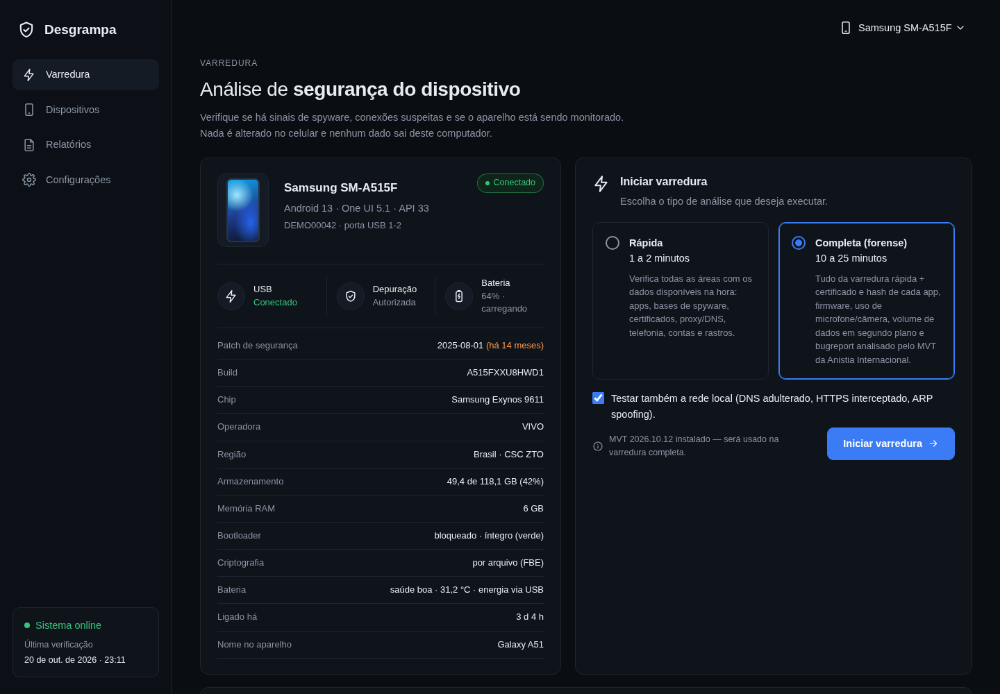
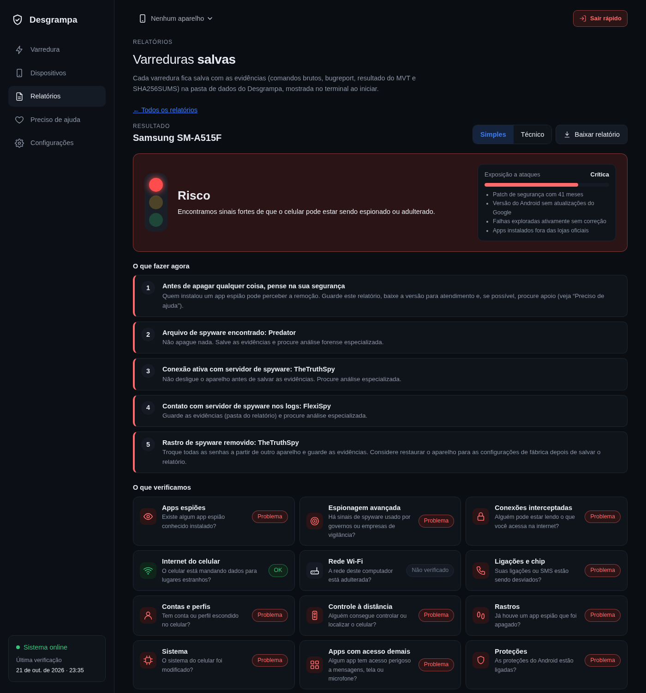

<h1 align="center">Desgrampa</h1>

<p align="center">
  <b>Detector de spyware, stalkerware, invasão e vulnerabilidades para Android e iPhone — self-hosted.</b><br>
  Painel web local · análise forense com o MVT da Anistia Internacional · nada do celular sai do seu computador.
</p>

<p align="center">
  
</p>

> [!IMPORTANT]
> **Se você acredita que está sendo vigiado por alguém próximo**, lembre que remover um app de
> monitoramento pode alertar quem o instalou. Planeje com apoio antes: no Brasil, **Ligue 180**,
> **190** em emergência e [stopstalkerware.org](https://stopstalkerware.org/resources/) (em inglês).
> **Se suspeita de uma organização ou governo**, não apague nada e procure a
> [Access Now Digital Security Helpline](https://www.accessnow.org/help/) (gratuita, em português)
> ou o [Amnesty Security Lab](https://securitylab.amnesty.org/get-help/).

## O que é

O **Desgrampa** (de *grampo*, a gíria para escuta clandestina) conecta-se a um Android via ADB (cabo ou Wi-Fi)
ou analisa o backup de um iPhone e procura sinais de que o aparelho está sendo monitorado, foi invadido ou
está vulnerável:

- **Stalkerware comercial**: mSpy, FlexiSPY, TheTruthSpy, Cerberus e outros. Compara nome, certificado e hash
  de cada app com ~650 pacotes, ~490 certificados e ~3.400 amostras conhecidas.
- **Spyware mercenário/estatal**: indicadores de Pegasus, Predator, Candiru, NoviSpy, Cellebrite, RCS Lab
  e outros. Na varredura completa, gera um bugreport e o analisa com o
  [MVT](https://github.com/mvt-project/mvt).
- **Interceptação de conexões**: certificados de segurança instalados, certificados injetados no sistema,
  proxy (global, por Wi-Fi e na conexão ativa), VPN, DNS privado e teste de DNS feito pelo próprio celular.
- **Rede local** (opcional, a partir do computador): DNS adulterado, HTTPS interceptado, proxy transparente
  e ARP spoofing.
- **Telefonia**: desvio de chamadas, rede 2G (ERB falsa), rede estrangeira sem roaming e apps que controlam
  SMS ou ligações.
- **Contas e perfis**: contas Google de terceiros, contas criadas por apps suspeitos e apps escondidos em
  perfis de trabalho, Pasta Segura ou apps duplicados.
- **Controle remoto**: administradores do aparelho, MDM, apps de acesso remoto e de rastreamento.
- **Rastros**: apps de espionagem que já foram desinstalados (histórico de bateria, estatísticas de uso,
  logs, pastas que sobraram) e endereços de spyware citados nos logs.
- **Integridade**: root, bootloader, dm-verity, SELinux, firmware assinado com chaves públicas de teste
  do AOSP, permissões privilegiadas concedidas via cabo e apps de sistema falsos.
- **Vulnerabilidades conhecidas**: falhas dos boletins de segurança do Android ainda abertas no aparelho
  (pelo patch), com destaque para as **exploradas ativamente** (catálogo CISA KEV), versão sem suporte,
  Chrome/WebView e apps de mensagem desatualizados e um **índice de exposição** de 0 a 100.
- **iPhone**: backup local (pelo cabo ou uma pasta do Finder/iTunes) analisado pelo MVT, perfis de
  configuração/MDM e versão do iOS comparada com as falhas da Apple exploradas ativamente.

O resultado aparece num **dashboard em dois modos**:

- **Simples** (padrão), para quem não é de TI: semáforo, índice de exposição, "o que fazer agora" e as 13
  áreas em perguntas do dia a dia.
- **Técnico**: achados agrupados por **categoria → origem**, busca, link direto para cada achado, tabela de
  CVEs com filtros, linha do tempo de instalações, dados de rede/telefonia/contas e checklist do que só dá
  para conferir na nuvem ou na operadora.

Relatórios: para imprimir ou salvar em PDF; **para atendimento/autoridade** (identificação, método, fatos,
hashes, cadeia de custódia e base legal); pacote de evidências `.zip`; JSON, STIX 2.1 e CSV.

<p align="center"></p>

## Princípios

- **A varredura é somente leitura.** Ela só executa comandos de consulta no celular; um teste automatizado
  garante que nenhum comando de alteração é usado.
- **Remoção só com confirmação manual.** Apps com achado crítico ou de spyware aparecem como *sugestão*. Para
  remover ou desativar, você confirma os riscos e digita o nome do pacote. Antes de qualquer alteração, uma
  cópia do APK é guardada como evidência, e toda ação fica registrada.
- **Self-hosted.** O painel roda só em `127.0.0.1`. Dados do celular (apps, contas, relatórios) nunca são
  enviados para lugar nenhum.
- **Evidência preservada.** Cada varredura salva a saída bruta de todos os comandos, o bugreport, o resultado
  do MVT e um `SHA256SUMS.txt`, pronto para entregar a um laboratório forense.
- **Segurança de quem usa.** Botão "Sair rápido" (ou Esc duas vezes), modo sem rastros (`--sem-rastros`),
  "Apagar tudo" e a página **Preciso de ajuda**, com Ligue 180, Defensoria Pública por estado, como guardar
  provas e o que diz a lei (CP 147-A, 147-B e 154-A; Lei 9.296, art. 10; Lei Maria da Penha, art. 7º, II).

### O que acessa a internet

Por transparência, estas são as únicas conexões feitas pelo **computador**:

| Quando | Para quê | Destino |
|---|---|---|
| Primeira execução / “Atualizar bases” | baixar as bases de indicadores e a de vulnerabilidades | `raw.githubusercontent.com` |
| Teste de DNS (todas as varreduras) | resposta de referência para domínios de teste | `cloudflare-dns.com` (DNS-over-HTTPS) |
| Teste de rede local (opcional) | testar DNS/HTTPS/proxy da sua rede | sites públicos como `google.com`, `example.com` e `cloudflare.com` |

O celular também resolve alguns domínios públicos de teste durante o teste de DNS.

## Instalação

**Jeito mais fácil:** baixe o executável do seu sistema na
[página de versões](https://github.com/bernardofernandezz/desgrampa/releases/latest). Ele já traz o `adb`:

| Sistema | Arquivo |
|---|---|
| Windows 10/11 | `desgrampa-windows.exe` (se o SmartScreen avisar, clique em “Mais informações › Executar assim mesmo”) |
| macOS | `desgrampa-macos` (na primeira vez: botão direito › Abrir) |
| Linux | `desgrampa-linux` (`chmod +x desgrampa-linux && ./desgrampa-linux`) |

Confira o arquivo baixado: `sha256sum -c SHA256SUMS.txt`, ou a origem com
`gh attestation verify desgrampa-windows.exe --repo bernardofernandezz/desgrampa`.

O executável não inclui o MVT (análise forense e iPhone). Para tê-lo, instale pelo Python:

```bash
# Python 3.10+ e adb
sudo apt install adb pipx           # Debian/Ubuntu (Arch: android-tools; macOS: brew install android-platform-tools)
pipx install "desgrampa[forense] @ git+https://github.com/bernardofernandezz/desgrampa"
```

Para iPhone pelo cabo, instale também o libimobiledevice (`sudo apt install libimobiledevice-utils` ou
`brew install libimobiledevice`). Sem ele, dá para analisar um backup feito no Finder/iTunes.

<details>
<summary>A partir do código-fonte</summary>

```bash
git clone https://github.com/bernardofernandezz/desgrampa && cd desgrampa
python -m venv .venv
.venv/bin/pip install -e ".[forense]"
.venv/bin/desgrampa
```

Rodando a partir do clone, bases e relatórios ficam em `data/` e `relatorios/` dentro do repositório
(ambos ignorados pelo git). Para gerar o executável: `python packaging/baixar_adb.py && pyinstaller packaging/desgrampa.spec`.
</details>

## Uso

```bash
desgrampa                      # abre o painel em http://127.0.0.1:8765
desgrampa --sem-rastros        # relatórios numa pasta temporária, apagada ao fechar
desgrampa --atendimento        # para Defensorias, delegacias e serviços de apoio (veja docs/atendimento.md)
desgrampa --port 9000 --no-browser
desgrampa atualizar-bases      # baixa ou atualiza as bases de indicadores e de vulnerabilidades
```

No Android:
1. Abra **Dispositivos** no painel e escolha a marca do celular: aparece o caminho exato para liberar as
   opções do desenvolvedor e ativar a **Depuração USB** (Samsung, Motorola, Xiaomi, Pixel, Realme/OPPO, LG, ASUS).
2. Conecte o cabo e toque em **Permitir** no aviso do celular. Sem cabo (Android 11+): use a
   **depuração por Wi-Fi** na mesma página (pareamento por código).
3. Escolha a varredura **Rápida** (1–2 min) ou **Completa/forense** (10–25 min) e clique em **Iniciar**.
4. Ao terminar, **desligue a depuração USB**.

No iPhone: em **Dispositivos › iPhone**, use “Fazer backup e analisar” (cabo, toque em “Confiar”) ou informe
a pasta de um backup existente. Backups criptografados trazem mais dados; a senha não é guardada.

Os dados ficam em `~/.local/share/desgrampa` (Linux), `~/Library/Application Support/Desgrampa` (macOS),
`%LOCALAPPDATA%\Desgrampa` (Windows) ou em `$DESGRAMPA_HOME`. Os relatórios contêm informações pessoais do
aparelho: **não os publique**.

| Variável | Uso |
|---|---|
| `DESGRAMPA_HOME` | pasta de dados (bases e relatórios) |
| `DESGRAMPA_ADB` | caminho do `adb`, se não estiver no PATH |
| `DESGRAMPA_MVT` / `DESGRAMPA_MVT_IOS` | caminho do `mvt-android` / `mvt-ios`, se não estiverem no mesmo ambiente |

## Limitações (leia antes de confiar no resultado)

- **Nenhuma ferramenta prova que um aparelho está limpo.** Os indicadores só reconhecem o que já foi
  documentado, e spyware de clique zero pode não deixar rastros acessíveis por ADB ou backup.
- Sem root, os certificados instalados pelo usuário só são detectados de forma indireta (pelo aviso
  “a rede pode estar sendo monitorada” e pelas políticas de MDM).
- Interceptação na operadora (fora o 2G) e contas invadidas na nuvem não aparecem pelo cabo. Por isso
  existe a aba **Verificações manuais**.
- A base de vulnerabilidades cobre os boletins do Android (AOSP, kernel, Qualcomm, Pixel) e as falhas
  exploradas da CISA; boletins próprios de Samsung/Motorola/Xiaomi e chips MediaTek/Exynos/Unisoc não estão
  incluídos, então o número real pode ser maior.
- iPhone: a análise depende do que o iOS coloca no backup; sem criptografia, vários dados ficam de fora.
- Alguns achados são heurísticos e podem gerar falsos positivos. Cada um explica o motivo; leia antes de agir.

Mais detalhes no [modelo de ameaça](docs/modelo-de-ameaca.md).

## Documentação

- [Guia do modo atendimento](docs/atendimento.md) — para pontos de apoio
- [Modelo de ameaça](docs/modelo-de-ameaca.md)
- [Indicadores brasileiros](docs/indicadores-br.md)
- [Roadmap](docs/ROADMAP.md) e [plano de escala nacional](docs/escala.md)

## Desenvolvimento

```bash
.venv/bin/pip install -e ".[dev]"
.venv/bin/python -m unittest -v      # roda offline, com bases de indicadores mínimas em tests/fixtures
.venv/bin/ruff check desgrampa tests
```

Veja [CONTRIBUTING.md](CONTRIBUTING.md) para a estrutura do projeto e como escrever uma nova verificação.
Vulnerabilidades: [SECURITY.md](SECURITY.md).

## Créditos

- Indicadores de stalkerware: [AssoEchap/stalkerware-indicators](https://github.com/AssoEchap/stalkerware-indicators)
  ([CC-BY 4.0](https://creativecommons.org/licenses/by/4.0/)).
- Indicadores de spyware mercenário: [mvt-project/mvt-indicators](https://github.com/mvt-project/mvt-indicators),
  que reúne investigações da Anistia Internacional, Citizen Lab, Google TAG, Meta, Lookout e outros.
- Vulnerabilidades: [OSV](https://osv.dev/) (Android Security Bulletins), [CISA KEV](https://www.cisa.gov/known-exploited-vulnerabilities-catalog), Chrome Version History e Apple software lookup (dados públicos).
- Legislação: textos conferidos em [ctresb/leis](https://github.com/ctresb/leis).
- Análise forense: [Mobile Verification Toolkit](https://github.com/mvt-project/mvt) (Anistia Internacional),
  usado como ferramenta externa, sem código incorporado.

As bases de indicadores são baixadas das fontes originais e não são redistribuídas, com duas exceções:
`desgrampa/dados/android_bulletins.json` (dados públicos de vulnerabilidades, gerado por `tools/build_bulletins.py`)
e `desgrampa/dados/br-indicators.yaml` (famílias brasileiras da AssoEchap, CC-BY 4.0, com atribuição).

## Licença

[GPL-3.0-or-later](LICENSE). Versões modificadas distribuídas a terceiros precisam continuar abertas.

---

<details>
<summary><b>English</b></summary>

**Desgrampa** is a self-hosted Android and iPhone spyware, intrusion and vulnerability scanner. Plug a phone in over USB/Wi-Fi (ADB) and
it checks for commercial stalkerware and mercenary spyware indicators (AssoEchap + MVT/Amnesty
indicators), runs the Amnesty International MVT on a bugreport, and looks for TLS interception
certificates, proxies, DNS tampering, call forwarding, 2G downgrades, hidden profiles, remote-access
and tracking apps, traces of uninstalled spyware and firmware integrity issues. Results are shown in a
local web dashboard (Brazilian Portuguese UI, simple and technical modes) and saved with hashed evidence.
It also lists unpatched Android Security Bulletin CVEs (flagging CISA KEV), analyses iPhone backups with MVT,
and has an attendance mode for support services (consent, evidence package, cleanup). Scans are read-only, and
app removal only happens after explicit manual confirmation. Install with
`pipx install "desgrampa[forense] @ git+https://github.com/bernardofernandezz/desgrampa"` and run `desgrampa`.
Licensed under GPL-3.0-or-later.
</details>
# desgrampa
